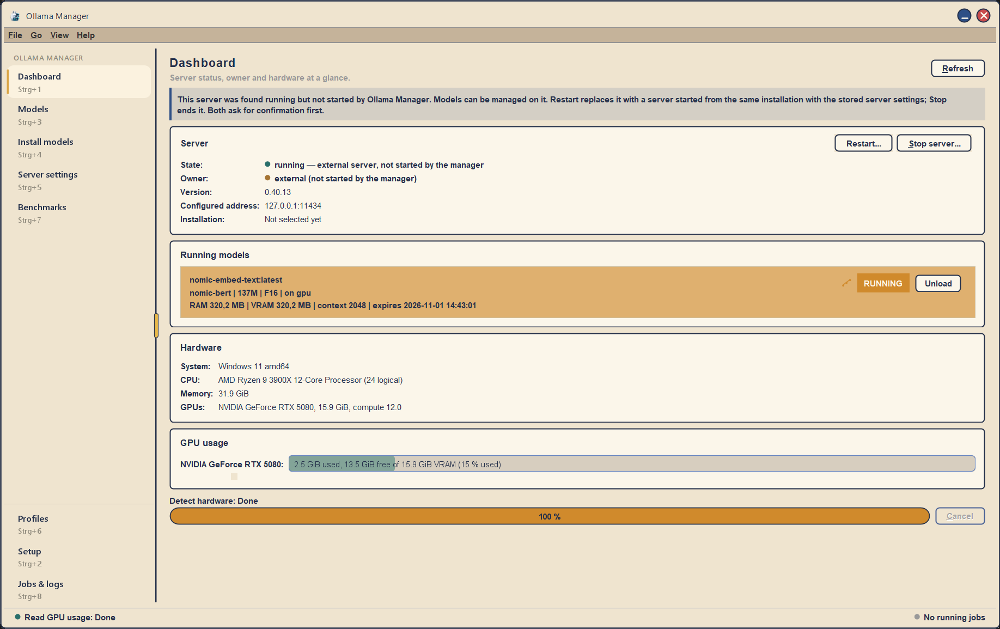
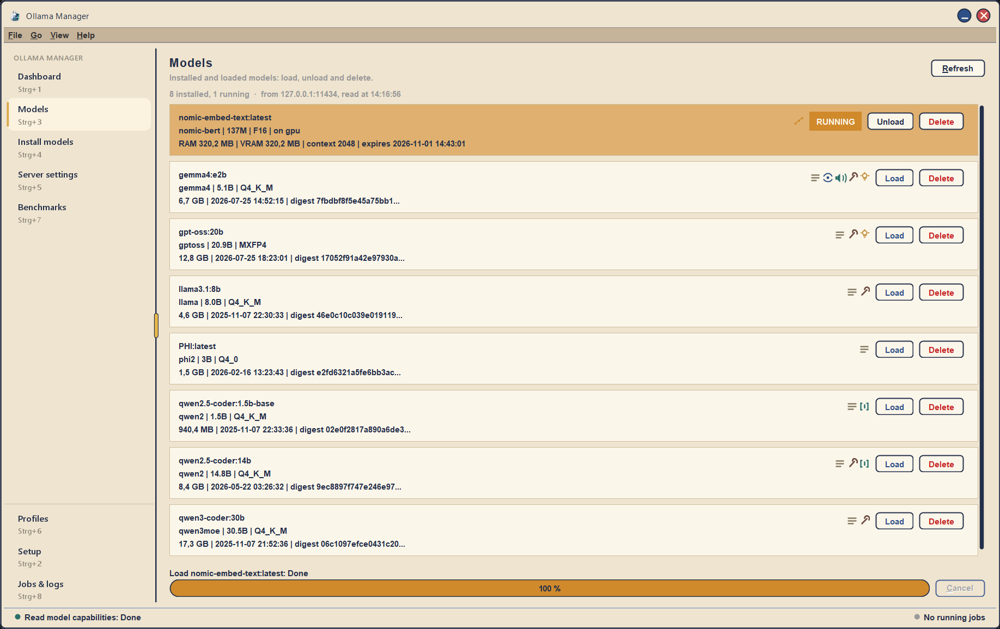
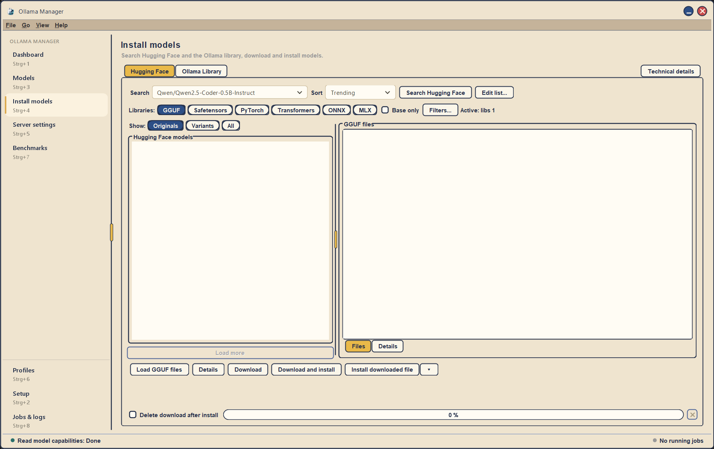
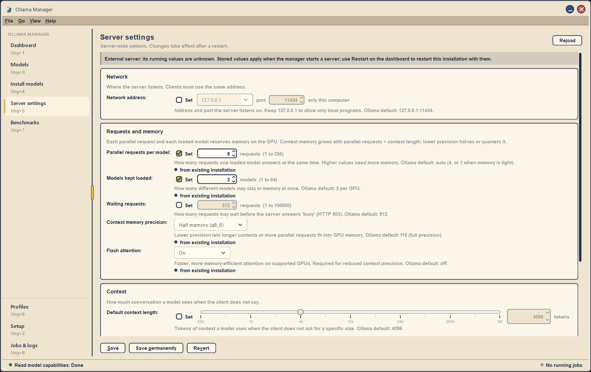
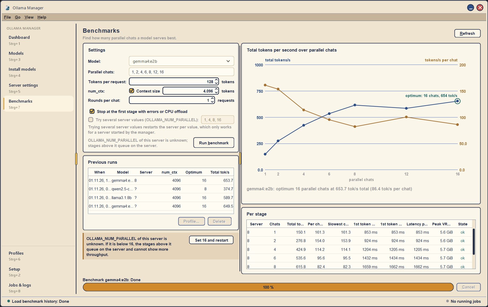
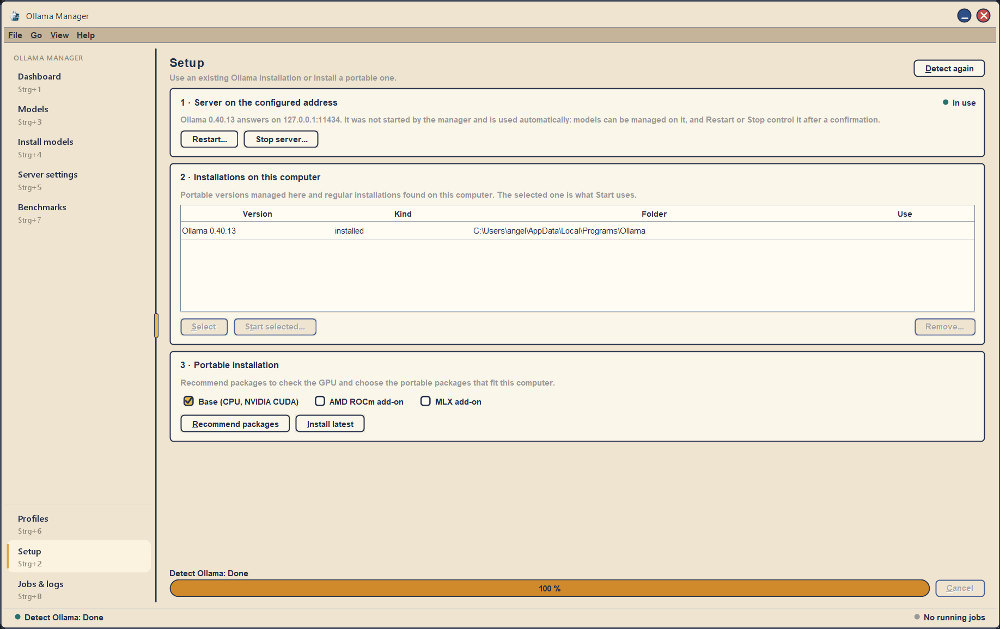

# Ollama Manager

Standalone desktop manager and optimizer for a local [Ollama](https://ollama.com) server.
Java 8 + Swing, MIT licensed. Windows x64 is the first supported platform.

It controls an existing Ollama installation or a portable one it installs itself, manages models,
edits the server-wide settings and benchmarks how many parallel chats a model serves best.



## Features

### Dashboard

Server state, owner (started by the manager or external), version, address and installation at a glance,
plus the running models, hardware (system, CPU, memory, GPUs) and live GPU usage with free VRAM.
A server that is already running on the configured address is adopted automatically; **Restart** and
**Stop server** control it after a confirmation.

### Models



Running models on top, installed models below, each as a card with family, size, quantization,
capability icons (tools, vision, audio, thinking, embedding, …) and **Load**, **Unload** and **Delete**.

### Install models



Search Hugging Face (library filters, originals/variants, GGUF file list and details) or the Ollama
library, then download, download and install, or install an already downloaded file.

### Server settings



Network address, parallel requests per model, models kept loaded, waiting requests, context memory
precision (KV cache), flash attention, default context length and more. Ollama defaults are shown only as
hints: a setting stays unset until you tick **Set**. Values configured for an existing installation are
adopted and marked *from existing installation*. **Save** stores the values for servers the manager starts;
**Save permanently** (Windows) also writes them into the user environment so the Ollama app uses them on its
next start. Server-wide settings take effect after a restart.

### Benchmarks



For a model and settings (tokens per request, `num_ctx`, rounds), the benchmark runs 1..N parallel chats,
measures tokens/s per chat and in total, plots total tokens/s over the number of parallel chats and marks
the **optimum**. The per-stage table shows time to first token, latency and peak VRAM; previous runs are kept
and can be turned into a profile. Optionally several `OLLAMA_NUM_PARALLEL` values are tried in one sweep
(restarts a server started by the manager).

### Setup



Shows the server on the configured address, lists regular and portable installations on this computer,
and installs a portable Ollama from the official GitHub releases with recommended packages for the GPU
(base CPU/NVIDIA CUDA, AMD ROCm, MLX).

### Profiles, jobs and logs

Profiles store tested server settings to activate later. **Jobs & logs** lists every background job with its
progress and log; long jobs can be cancelled.

## Requirements

- Java Runtime 8 or newer on `PATH` (the manager is built and tested on Java 8).
- Ollama itself is **not** bundled. It is either an existing installation or a portable
  distribution the manager downloads from the official GitHub releases on explicit request (issue #4).

## Run

```
java -jar ollama-manager.jar
```

On Windows the ZIP distribution also contains `ollama-manager.cmd`, which starts the JAR with `javaw`
(no console window). `java -jar ollama-manager.jar --smoke-test` checks that all modules load and exits
without opening a window.

## Build

```
./gradlew clean build        # Windows: gradlew.bat clean build
```

Run Gradle with a **JDK 8** (`JAVA_HOME`) so tests execute on a real Java 8 runtime. The build
deliberately stays on Gradle 8.x, the last line that can run on Java 8; its deprecation notice about
Java 8 is expected. The wrapper distribution is pinned by SHA-256.

Outputs:

- `manager-swing/build/executable/ollama-manager.jar` – executable JAR with all modules
- `manager-swing/build/distributions/ollama-manager-<version>.zip` – JAR, launcher, README, LICENSE

`build` also runs `verifyArchitecture` (forbidden imports per layer) and the `java -jar --smoke-test`.

## Architecture

| Module | Content | May depend on |
|---|---|---|
| `manager-domain` | Immutable value objects and rules | nothing |
| `manager-application` | Ports, error and cancellation contract, use cases | domain |
| `manager-infrastructure` | Adapters: process, HTTP, GitHub, ZIP, hardware, JSON persistence | application, domain |
| `manager-swing` | Swing UI and composition root (`OllamaManagerApp`) | all |

Contracts and file ownership for parallel work: [docs/CONTRACTS.md](docs/CONTRACTS.md).

## Security and lifecycle semantics

- The default bind address is `127.0.0.1:11434`; nothing is exposed to the network by default.
- Server settings are passed to a server the manager starts via `ProcessBuilder.environment()`. Windows user
  environment variables are written only by an explicit, confirmed **Save permanently**.
- `OLLAMA_NUM_PARALLEL`, `OLLAMA_MAX_LOADED_MODELS`, `OLLAMA_MAX_QUEUE`, `OLLAMA_CONTEXT_LENGTH`,
  `OLLAMA_KV_CACHE_TYPE`, `OLLAMA_FLASH_ATTENTION`, `OLLAMA_KEEP_ALIVE` and `OLLAMA_MODELS` are server-wide
  and need a restart of a server the manager started. Per-request options such as `num_ctx` do not, and
  only affect requests the manager itself sends.
- An Ollama server already running on the configured address is adopted automatically and fully managed.
  Stopping or restarting it always asks for confirmation first, because running requests may be aborted.
- Preferences are stored in `%LOCALAPPDATA%\AresStack\OllamaManager\configuration.json`
  (`~/.ollama-manager` elsewhere), written atomically with a `.bak` copy for recovery. No credentials.

## Test evidence

Automated tests use fakes only. Native Ollama, download and GPU behaviour require the manual Windows
checks named in each issue and are not claimed by CI.

## License

MIT © 2026 AresStack. Bundled libraries: see [THIRD-PARTY-NOTICES.md](THIRD-PARTY-NOTICES.md).
Ollama is a separate project under its own license.
